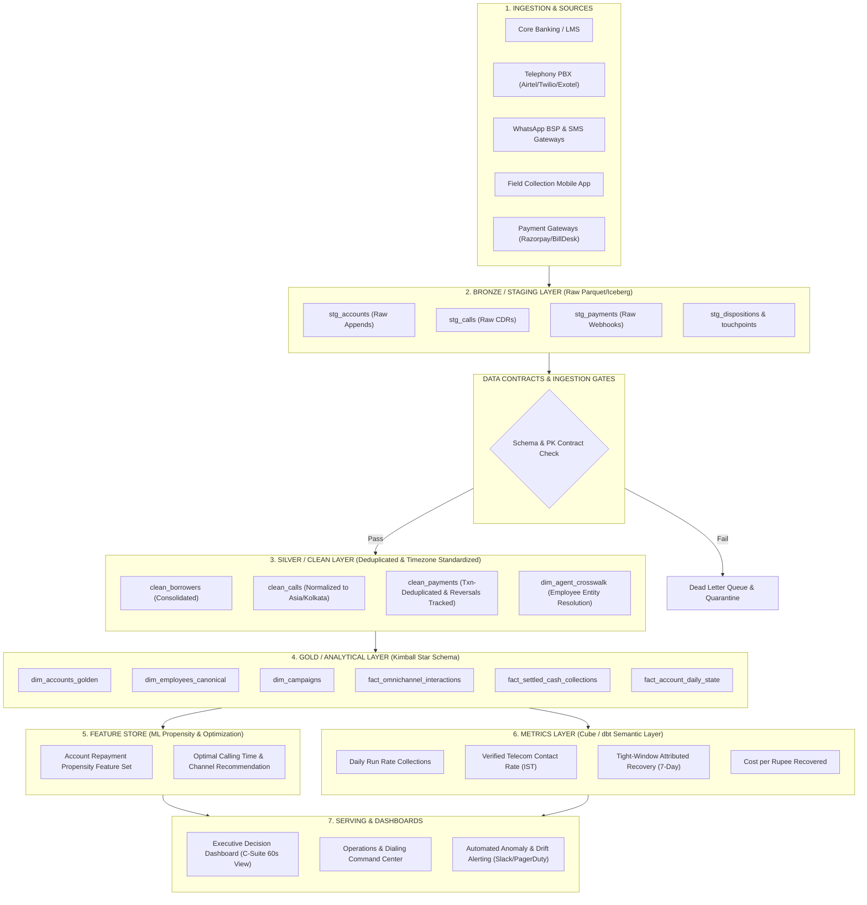
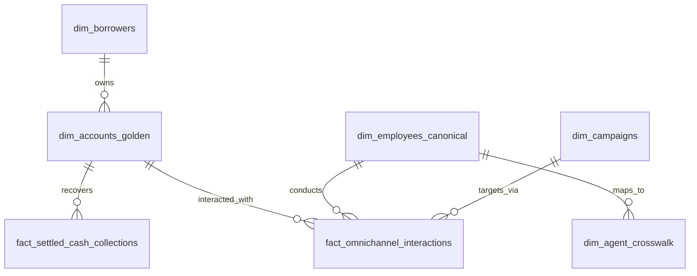

# Production Analytics System Architecture & Design Specification
**Enterprise Collections Data Platform (Lakehouse & Medallion Design)**  
**Target Audience:** Engineering Leads, Data Architects, Analytics Engineers, C-Level Leadership  

---

## 1. System Overview & Architectural Blueprint

To prevent historical reporting errors, phantom attribution, duplicate counting, and timezone distortions from recurring, we specify a production-grade **Medallion Lakehouse Architecture** (`Raw → Staging → Clean → Golden → Feature → Metrics → Dashboard`).

### End-to-End Architectural Flow Diagram (Mermaid)



---

## 2. Layer-by-Layer Architectural Specifications

### 2.1 Raw Ingestion Layer (Bronze)
* **Ingestion Protocol:** Event-driven Kafka / AWS Kinesis streams for real-time webhooks (payments, call dispositions, WhatsApp delivery) landed into cloud object storage (S3 / GCS) formatted as Apache Iceberg tables.
* **Storage Format:** Append-only columnar Parquet with ingestion metadata:
  * `_ingested_at_utc`: System ingest timestamp.
  * `_source_system`: Source identifier (e.g., `PBX_TWILIO_PROD_1`).
  * `_raw_payload_hash`: SHA-256 hash of the incoming payload for idempotency.

### 2.2 Staging & Data Contracts
Every raw table must implement a rigid **Data Contract**. If incoming data violates the contract, records are routed to a **Dead Letter Queue (DLQ)** without halting the main pipeline.

#### Sample Data Contract: `payments_webhook_contract.json`
```json
{
  "$schema": "https://json-schema.org/draft/2020-12/schema",
  "title": "PaymentEventContract",
  "type": "object",
  "properties": {
    "payment_id": { "type": "string", "pattern": "^PAYMENT[0-9]{7}$" },
    "account_id": { "type": "string", "pattern": "^ACC[0-9]{7}$" },
    "payment_reference": { "type": "string", "pattern": "^TXN[0-9]{10}$" },
    "amount": { "type": "number", "minimum": 1.0, "maximum": 5000000.0 },
    "payment_status": { "type": "string", "enum": ["SUCCESS", "FAILED", "PENDING", "REVERSED"] },
    "event_at": { "type": "string", "format": "date-time" }
  },
  "required": ["payment_id", "account_id", "payment_reference", "amount", "payment_status", "event_at"]
}
```

### 2.3 Silver / Cleaning Layer
* **Deduplication Engine:**
  * Deduplicate `payment_reference`: Keep the earliest valid `SUCCESS` settlement using window functions (`ROW_NUMBER() OVER (PARTITION BY payment_reference ORDER BY event_at ASC)`).
  * Flag retries and downstream webhook duplicate delivery.
* **Timezone Standardizer:**
  * Transform all input timestamps (`UTC`, `Asia/Dubai`, `Asia/Kolkata`) into standardized canonical `Asia/Kolkata` (IST) timestamp columns (`event_at_ist`, `event_date_ist`, `event_hour_ist`).
* **Entity Resolution:**
  * Maintain SCD Type 2 mapping of `agent_id` to `employee_code` via `dim_agent_crosswalk`.

### 2.4 Gold / Analytical Layer (Kimball Star Schema)
* **Primary Dimensions:**
  * `dim_accounts_golden`: Static portfolio baseline (30,000 accounts), storing static principal, opening date, and borrower demographics.
  * `dim_employees_canonical`: Consolidated 1,099 employees with verified tenure, team, and carrier assignments.
  * `dim_campaigns`: Campaign configurations and strategy versions.
* **Core Fact Tables:**
  * `fact_settled_cash_collections`: Net settled ledger-level cash recoveries deduplicated on transaction reference.
  * `fact_omnichannel_interactions`: Unified event log across Voice, WhatsApp, SMS, and Field visits.
  * `fact_account_daily_state`: Periodic snapshot tracking daily outstanding balance, DPD, and active status.

---

## 3. Data Lineage & Entity Relationship Model



---

## 4. Operationalization & Production Reliability

### 4.1 Incremental Processing & Watermarking
* Pipelines run on an incremental **hourly micro-batch** schedule using dbt / Apache Spark.
* Watermarking is configured with a **72-hour sliding lookback window** to capture late-arriving events:
  ```sql
  WHERE event_at >= (SELECT MAX(event_at) - INTERVAL '72 HOURS' FROM {{ this }})
  ```

### 4.2 Handling Late-Arriving Data & Backfills
* **Late Payments & Bank Settlements:** If a payment arrives 3 days after a call or PTP, it is captured during the 72-hour micro-batch and attributed via the event-time ordering engine.
* **Idempotent Backfills:** All transformation queries are written with `MERGE INTO` / `INSERT OVERWRITE` partition logic keyed on `payment_reference` and `call_id`, guaranteeing idempotency during re-runs.

### 4.3 Automated Data Quality Checks (dbt / Great Expectations)
The pipeline enforces blocking CI/CD and runtime tests before metric tables are refreshed:
1. `expect_column_values_to_be_unique` on `payment_reference` in `fact_settled_cash_collections`.
2. `expect_column_values_to_not_be_null` on `account_id`, `event_at_ist`, and `amount`.
3. `expect_table_row_count_to_equal_other_table` ensuring no accounts are dropped from `dim_accounts_golden`.
4. `expect_call_disposition_consistency`: Alert if dispositions exist where `call_status != 'ANSWERED'`.

### 4.4 Anomaly Detection & Monitoring
* **Daily Run Rate Watchdog:** Automated alert triggers if daily collections deviate by more than $\pm 2.5 \sigma$ from the 30-day moving average.
* **Calendar-Length Normalizer:** The semantic metrics layer automatically calculates:
  $$\text{Daily Run Rate} = \frac{\text{Net Settled Cash}}{\text{Active Operating Days in Month}}$$
  Disallowing raw un-normalized month-to-month total comparisons in all C-suite dashboards.
* **Timezone Guard:** Continuous check for timestamps lacking explicit UTC offsets.

